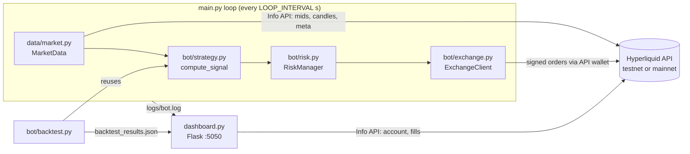

# Hyperliquid Trading Bot

[](https://github.com/OplopUser/hyper/actions/workflows/build-and-push.yml)

A Python bot that trades [Hyperliquid](https://hyperliquid.xyz) perpetuals using an EMA crossover with RSI, higher-timeframe trend and volatility filters, ATR-based stops and a small risk-management layer. It ships with a backtester, a Flask monitoring dashboard and an ARM64 Docker image for running on a Raspberry Pi.

> **Experimental software that can trade real funds.** Run it on testnet first. Nothing here is financial advice. See [Risks & limitations](#risks--limitations).

---

## Contents

- [Overview](#overview)
- [Features](#features)
- [Strategy](#strategy)
- [Risk management](#risk-management)
- [Architecture](#architecture)
- [Requirements](#requirements)
- [Setup](#setup)
- [Usage](#usage)
- [Docker / Raspberry Pi deployment](#docker--raspberry-pi-deployment)
- [Project structure](#project-structure)
- [Risks & limitations](#risks--limitations)
- [License](#license)

---

## Overview

The bot runs a polling loop (every 60 seconds by default). On each iteration it reads account equity, then for every configured symbol it:

1. fetches the mid-price and checks any open position against its stop-loss / take-profit,
2. runs pre-trade risk checks,
3. pulls 15m candles plus 4h candles from the Hyperliquid Info API,
4. evaluates the strategy on the last **closed** 15m candle,
5. if a signal passes every filter, sizes the position and sends a market order through the official [`hyperliquid-python-sdk`](https://github.com/hyperliquid-dex/hyperliquid-python-sdk).

All trading goes through an API (agent) wallet that signs on behalf of your main account, so the main account's private key never has to sit on the machine running the bot.

## Features

- **Strategy:** EMA(9/21) crossover, RSI(14) range filter, 4h EMA(21) trend filter, ATR-percentile volatility filter
- **ATR-based exits:** stop-loss at 1.5 × ATR, take-profit at 3.0 × ATR
- **Risk controls:** fixed-fractional position sizing, margin cap, max concurrent positions, one position per coin, minimum order size, drawdown halt
- **Multi-symbol:** trades every coin listed in `SYMBOLS`
- **Signal de-duplication:** a closed candle can only produce one signal per symbol, so 60-second polling does not re-fire the same crossover
- **Graceful shutdown:** `SIGINT` / `SIGTERM` finish the current iteration, then close every position the bot opened
- **Backtester:** replays the same `compute_signal()` used live and writes `backtest_results.json`
- **Dashboard:** Flask web UI with equity, open positions, fills, PnL stats, backtest results and a live log tail
- **Structured logging:** `[SIGNAL]`, `[ORDER]`, `[POSITION]` and `[RISK]` events to the console and a rotating log file
- **Deployment:** Dockerfile, `docker-compose.yml` (bot and dashboard as separate services) and a GitHub Actions workflow that builds and pushes a `linux/arm64` image to GHCR
- **Historical data module:** an S3 client for [Hydromancer Reservoir](https://hydromancer.xyz) (see [Historical data](#historical-data-hydromancer-reservoir))

## Strategy

Defined in [`bot/strategy.py`](bot/strategy.py). Parameters come from `StrategyConfig` in [`config.py`](config.py).

### Indicators

| Indicator | Default | Env override |
|---|---|---|
| Fast EMA (close) | 9 | `EMA_FAST` |
| Slow EMA (close) | 21 | `EMA_SLOW` |
| RSI | 14 | `RSI_PERIOD` |
| ATR | 14 | `ATR_PERIOD` |
| Primary timeframe | `15m`, 200 candles | `config.py` only |
| Higher timeframe (HTF) | `4h`, 100 candles, EMA(21) | `config.py` only |

At least 50 candles are needed before any signal is produced. The strategy looks at the last closed candle (`iloc[-2]`) and the one before it (`iloc[-3]`) and ignores the candle that is still forming.

### Entry rules

| Signal | Conditions (all must hold) |
|---|---|
| **Long** | Fast EMA crosses **above** slow EMA · 30 < RSI < 70 · 4h trend is not bearish · volatility regime is normal |
| **Short** | Fast EMA crosses **below** slow EMA · 30 < RSI < 70 · 4h trend is not bullish · volatility regime is normal |
| **None** | No crossover, or any filter blocks |

**Filters**

- **RSI range:** the signal is dropped when RSI is at or below 30 or at or above 70 (`rsi_oversold` / `rsi_overbought`).
- **HTF trend** (`htf_enabled = True`): the 4h close compared with the 4h EMA(21) gives `bullish` or `bearish`. Longs are blocked in a bearish trend and shorts in a bullish one. If the trend is `unknown` (not enough 4h data), the filter does not block.
- **Volatility regime** (`vol_filter_enabled = True`): the current ATR is ranked against the last 100 ATR values. Below the 20th percentile is `low` (ranging) and above the 95th is `high` (news/chaos); both block the signal.

### Stop-loss and take-profit

Computed from the signal candle's close and ATR:

```
Long:   stop-loss = close − 1.5 × ATR     take-profit = close + 3.0 × ATR
Short:  stop-loss = close + 1.5 × ATR     take-profit = close − 3.0 × ATR
```

That is a 2 : 1 reward-to-risk ratio measured from the candle close. The order fills near the current mid-price, so the realised ratio differs slightly. Before ordering, the bot checks that the levels are on the correct side of the entry price (`SL < entry < TP` for longs, `TP < entry < SL` for shorts).

### Exits

In live trading a position is closed with a reduce-only market order when, on a loop iteration, the mid-price has reached the stop-loss or take-profit. The bot also stops tracking a position that is no longer open on the exchange (closed manually or liquidated). **Stops are enforced by the bot's polling loop, not by trigger orders resting on the exchange.**

## Risk management

Implemented in [`bot/risk.py`](bot/risk.py). Defaults come from `RiskConfig` in [`config.py`](config.py).

| Control | Default | Env override | Behaviour |
|---|---|---|---|
| Risk per trade | 2 % of equity | `MAX_RISK_PER_TRADE` | Drives position size (below) |
| Max concurrent positions | 3 | `MAX_POSITIONS` | New entries blocked at the limit |
| One position per coin | always on | — | No pyramiding or adding to a position |
| Drawdown halt | 10 % from peak | `config.py` only | Blocks new entries once equity falls 10 % below the peak seen since start-up. Open positions keep being managed. The halt lasts until the bot restarts. |
| Leverage | 1× (cross) | `config.py` only | Set explicitly on every symbol at start-up |
| Minimum order | $10 notional | `config.py` only | Smaller orders are skipped |

**Position sizing**

```
risk_amount = equity × MAX_RISK_PER_TRADE
size        = risk_amount / |entry − stop_loss|          (× leverage when leverage > 1)
size        = min(size, equity × leverage × 0.95 / entry)  # margin cap, 5 % buffer
size        = floor(size, exchange size decimals)
```

The margin cap means that with tight stops the actual risk can be **lower** than 2 %. When leverage is above 1, the size is multiplied by the leverage, so the risk per trade becomes roughly leverage × `MAX_RISK_PER_TRADE`.

## Architecture



| Module | Responsibility |
|---|---|
| `main.py` | Entry point: config validation, leverage setup, main loop, signal handling, shutdown |
| `config.py` | Reads `.env`; holds `StrategyConfig`, `RiskConfig`, network and loop settings |
| `bot/strategy.py` | Indicators (EMA, RSI, ATR), crossover detection, HTF and volatility filters, SL/TP |
| `bot/risk.py` | Position sizing, pre-trade checks, SL/TP validation, drawdown halt, in-memory position records |
| `bot/exchange.py` | Wrapper around the SDK `Exchange`: market/limit orders, cancels, close, leverage, account queries |
| `bot/backtest.py` | Bar-by-bar backtester and CLI |
| `data/market.py` | Hyperliquid Info API: mid-prices, candles, L2 book, metadata, funding |
| `data/reservoir.py` | Hydromancer Reservoir S3 reader (candles, fills, snapshots) |
| `utils/logger.py` | Console and rotating-file logging, structured trade-event helpers |
| `dashboard.py` | Flask dashboard and JSON API (`/api/all`, `/api/account`, `/api/fills`, `/api/logs`) |

## Requirements

- Python 3.9 or newer (the Docker image uses Python 3.11)
- A Hyperliquid account, plus an **API wallet** created for it (start on testnet)
- Docker, for container deployment (optional)
- AWS credentials, only if you use `data/reservoir.py` (optional)

Python dependencies are listed in [`requirements.txt`](requirements.txt): `hyperliquid-python-sdk`, `pandas`, `numpy`, `ta`, `flask`, `python-dotenv`, `requests`, `boto3`, `pyarrow`.

## Setup

```bash
git clone https://github.com/OplopUser/hyper.git
cd hyper
python -m venv .venv
source .venv/bin/activate        # Windows: .venv\Scripts\activate
pip install -r requirements.txt
cp .env.example .env
```

### 1. Create an API wallet (recommended)

In the Hyperliquid app (testnet: <https://app.hyperliquid-testnet.xyz>), generate an **API wallet** (agent) for your account. The bot signs orders with the API wallet's key and acts for your main account (`ACCOUNT_ADDRESS`). An API wallet can trade but cannot withdraw, so it limits the damage if the key on the bot machine leaks. Fund the main account; testnet funds are available from the testnet app.

### 2. Fill in `.env`

| Variable | Required | Default | Description |
|---|---|---|---|
| `PRIVATE_KEY` | yes | — | Private key of the **API wallet** that signs orders |
| `API_WALLET_ADDRESS` | yes | — | Address of that API wallet (checked at start-up) |
| `ACCOUNT_ADDRESS` | yes | — | Main account address that holds the funds; used for equity, position and fill queries (bot and dashboard) |
| `USE_TESTNET` | no | `true` | `true` uses `api.hyperliquid-testnet.xyz`; `false` uses mainnet |
| `SYMBOLS` | no | `ETH,SOL` | Comma-separated coins to trade |
| `SYMBOL` | no | — | Legacy single-symbol setting, read only when `SYMBOLS` is unset |
| `EMA_FAST` / `EMA_SLOW` | no | `9` / `21` | EMA periods |
| `RSI_PERIOD` | no | `14` | RSI period |
| `ATR_PERIOD` | no | `14` | ATR period |
| `MAX_RISK_PER_TRADE` | no | `0.02` | Fraction of equity risked per trade |
| `MAX_POSITIONS` | no | `3` | Max concurrent positions |
| `LOOP_INTERVAL` | no | `60` | Seconds between loop iterations |
| `DASHBOARD_PORT` | no | `5050` | Dashboard port (`python dashboard.py` only; the compose file maps 5050) |
| `AWS_ACCESS_KEY_ID` / `AWS_SECRET_ACCESS_KEY` | no | — | Used only by `data/reservoir.py`; falls back to the default AWS credential chain |
| `AWS_DEFAULT_REGION` | no | `us-east-1` | Region for the Reservoir S3 client |

All other parameters (RSI bounds, ATR multipliers, timeframes, filter settings, drawdown halt, leverage, minimum order) are edited directly in `config.py`.

`.env` is listed in `.gitignore` and `.dockerignore`. Never commit it.

## Usage

### Live trading

```bash
python main.py
```

It logs the active configuration, sets leverage on each symbol and starts the loop. Stop it with `Ctrl+C` (or `SIGTERM`): the bot finishes the current iteration and **closes all positions it opened** before exiting.

```bash
python main.py --backtest   # run the backtester first, then start live trading
```

### Backtesting

```bash
python -m bot.backtest            # symbols from SYMBOLS
python -m bot.backtest ETH SOL    # specific symbols
```

The backtester needs no wallet keys. It downloads recent candles from the Hyperliquid candle endpoint (the configured lookback: 200 × 15m candles, about two days), then:

- replays `compute_signal()` bar by bar with $1,000 starting equity,
- sizes trades with `MAX_RISK_PER_TRADE` and the minimum-order rule,
- exits on SL/TP (checked against each bar's high/low and filled at the level), on an opposite signal, or at the end of the data,
- prints trades, win rate, total PnL, max drawdown, Sharpe ratio (annualised assuming 15m bars), average win/loss and profit factor,
- saves everything to `backtest_results.json`, which the dashboard displays.

See [Risks & limitations](#risks--limitations) for what the simulation leaves out.

### Dashboard

```bash
python dashboard.py
```

Serves on `http://localhost:5050` (or `DASHBOARD_PORT`) and refreshes every 5 seconds. It shows account equity, unrealised PnL, margin used, withdrawable balance, open positions with mark and liquidation prices, the last fills with closed PnL and fees, win-rate stats, a cumulative-PnL sparkline, backtest results and the tail of `logs/bot.log`. A badge shows whether it is pointed at **TESTNET** or **MAINNET**. It is read-only and needs only `ACCOUNT_ADDRESS`, not the private key.

### Logs

- Console: INFO and above, coloured when attached to a TTY
- File: `logs/bot.log`, DEBUG and above, rotated at midnight UTC, 7 files kept

```
2026-03-28 12:00:00  INFO      trade  [SIGNAL] symbol=ETH direction=LONG fast_ema=... slow_ema=... rsi=... atr=...
2026-03-28 12:00:01  INFO      trade  [ORDER] action=SUBMIT symbol=ETH side=buy size=... price=MARKET order_id=n/a
```

### Historical data (Hydromancer Reservoir)

[`data/reservoir.py`](data/reservoir.py) reads Parquet files from the requester-pays bucket `s3://hyperliquid-reservoir` (your AWS account pays the S3 request costs):

| Function | S3 layout | Notes |
|---|---|---|
| `get_candles(coin, days, resample_to, fallback_fn)` | `candles/<COIN>/YYYY-MM-DD.parquet` | 1-second OHLCV, optional resampling (e.g. `"15min"`), falls back to `fallback_fn` if S3 is unavailable |
| `get_fills(days, coin)` | `fills/YYYY-MM-DD.parquet` | Trades, liquidations, ADLs |
| `get_snapshots(days)` | `snapshots/YYYY-MM-DD.parquet` | Daily position and balance snapshots |

The live bot and the backtester do **not** call this module at the moment; both use the Hyperliquid candle endpoint. It is there for longer-horizon research and backtests.

## Docker / Raspberry Pi deployment

The [`Dockerfile`](Dockerfile) builds a `python:3.11-slim-bookworm` image that contains the bot and the dashboard (port 5050). By default it runs `python main.py`.

### Pre-built ARM64 image (CI)

[`.github/workflows/build-and-push.yml`](.github/workflows/build-and-push.yml) runs on every push to `main`. It builds a `linux/arm64` image with QEMU/Buildx and pushes it to GitHub Container Registry as `ghcr.io/<owner>/<repo>:latest` and `:<commit-sha>`.

### Run with Docker Compose

[`docker-compose.yml`](docker-compose.yml) starts two containers from the same image, both reading `.env`:

| Service | Command | Notes |
|---|---|---|
| `bot` | `python main.py` | `restart: unless-stopped`, writes `./logs` |
| `dashboard` | `python dashboard.py` | Publishes port `5050`, reads `./logs` |

On the Pi (or any ARM64 host):

```bash
cp .env.example .env    # then fill it in
docker compose pull
docker compose up -d
docker compose logs -f bot
```

The compose file references the maintainer's GHCR image. If you fork the repo, change `image:` to your own `ghcr.io/<you>/hyper:latest`, or build locally:

```bash
docker build -t hyper .
```

and set `image: hyper` for both services. A plain `docker build` targets the host's architecture.

Notes:

- `docker compose stop`, `restart`, or an image update sends `SIGTERM` to the bot, and the bot **closes its open positions** on the way out.
- `backtest_results.json` is not mounted into the containers, so the dashboard's backtest panel stays empty under Compose unless you add a volume for it.
- The dashboard has no authentication and listens on all interfaces. Keep port 5050 on a trusted network or behind a reverse proxy with auth.

[`watchdog.sh`](watchdog.sh) is an older non-Docker alternative: it starts `main.py` and `dashboard.py` and restarts either one if it dies (checked every 30 seconds). The interpreter path at the top of the script is machine-specific; edit it before use.

## Project structure

```
hyper/
├── main.py                        # Entry point and main loop
├── config.py                      # Configuration (env vars + dataclass defaults)
├── dashboard.py                   # Flask monitoring dashboard
├── bot/
│   ├── strategy.py                # EMA/RSI/ATR signal + HTF and volatility filters
│   ├── risk.py                    # Sizing, drawdown halt, SL/TP checks
│   ├── exchange.py                # Order and account wrapper around the SDK
│   └── backtest.py                # Backtester + CLI
├── data/
│   ├── market.py                  # Hyperliquid Info API (live data)
│   └── reservoir.py               # Hydromancer Reservoir S3 reader
├── utils/
│   └── logger.py                  # Logging setup and trade-event helpers
├── strategy_diagram.html          # Visual explainer of the strategy
├── trade_activation_diagram.html  # Visual flow from loop tick to order
├── requirements.txt
├── .env.example
├── Dockerfile
├── docker-compose.yml
├── watchdog.sh
└── .github/workflows/build-and-push.yml
```

The two HTML diagrams open directly in a browser. `strategy_diagram.html` predates the HTF and volatility filters and still mentions BTC and Reservoir as the live data source; this README and the code are authoritative.

## Risks & limitations

**This bot can lose real money.** It is a personal, experimental project and comes with no warranty. Nothing in this repository is financial advice. Run it on testnet and with amounts you can afford to lose.

Known limitations:

- **No exchange-side stops.** SL/TP are checked against the mid-price once per loop. Between checks, or while the bot is down, positions are unprotected, and gaps can fill well past the stop.
- **State lives in memory.** Tracked positions, peak equity and the drawdown halt reset on restart. Positions left open before a restart are not managed by the new process; close them manually.
- **Shutdown closes positions.** Any `SIGINT`/`SIGTERM` (including container restarts and image updates) flattens the positions the bot opened.
- **No exit on opposite signal in live trading.** Live positions close only via SL/TP. The backtester also exits on an opposite signal, so the two can diverge.
- **Backtest is a rough check, not evidence of an edge.** It covers only about 200 recent 15m candles, ignores fees, slippage and funding, fills at candle closes, and evaluates the HTF trend filter on the latest 4h data for every bar (look-ahead). Don't read much into its numbers.
- **Polling, not streaming.** The bot reacts on a 60-second cycle, not to tick data.
- **Limited tests.** The repository has no automated test suite; CI only builds the Docker image.
- **Testnet ≠ mainnet.** Liquidity, slippage and fills differ.

## License

No license file yet — all rights reserved.
